# Printzy user guide

Printzy is a free app for Windows and Linux that opens Publisher's `.pub` files, lets you change them, and prints
them or saves them as PDFs. It doesn't need Publisher, an account or the internet. It also makes new documents:
flyers, newsletters, certificates, business cards, menus, labels, tickets and booklets.

This guide starts with installing Printzy and opening your first `.pub` file, then explains every part of the app.
If you're new, read **Part 1** and **Part 2**. The rest is there when you need it.

In the pictures, **blue numbered boxes** show what to click. The numbers match the steps under each picture.
Everything shown is made up: the club, the school, the names and the folders.

## Contents

**Part 1. Get started**
1. [What you need](#1-what-you-need)
2. [Install Printzy on Windows](#2-install-printzy-on-windows)
3. [Install Printzy on Linux](#3-install-printzy-on-linux)
4. [The first start](#4-the-first-start)
5. [A tour of the window](#5-a-tour-of-the-window)

**Part 2. Your Publisher files**
6. [Open a .pub file](#6-open-a-pub-file)
7. [The import report](#7-the-import-report)
8. [Missing fonts](#8-missing-fonts)
9. [Convert with your installed Publisher](#9-convert-with-your-installed-publisher)
10. [Rescue a folder](#10-rescue-a-folder)
11. [What can't come across](#11-what-cant-come-across)

**Part 3. Make something**
12. [Start from a template](#12-start-from-a-template)
13. [A blank page and page sizes](#13-a-blank-page-and-page-sizes)
14. [Text boxes and text](#14-text-boxes-and-text)
15. [Pictures](#15-pictures)
16. [Shapes, lines, tables and QR codes](#16-shapes-lines-tables-and-qr-codes)
17. [Arrange and align](#17-arrange-and-align)
18. [Colour and font schemes](#18-colour-and-font-schemes)

**Part 4. Longer documents**
19. [Pages and the pages panel](#19-pages-and-the-pages-panel)
20. [Master pages and page numbers](#20-master-pages-and-page-numbers)
21. [Text that flows between boxes](#21-text-that-flows-between-boxes)
22. [Make a newsletter](#22-make-a-newsletter)
23. [Make a booklet](#23-make-a-booklet)

**Part 5. Mail merge**
24. [Certificates for a whole class](#24-certificates-for-a-whole-class)
25. [Address labels](#25-address-labels)
26. [Name badges with photos](#26-name-badges-with-photos)
27. [Numbered tickets](#27-numbered-tickets)

**Part 6. Printing and PDFs**
28. [The design checker](#28-the-design-checker)
29. [Export a PDF for printing](#29-export-a-pdf-for-printing)
30. [A PDF for email](#30-a-pdf-for-email)
31. [Pictures for social media](#31-pictures-for-social-media)
32. [Print at home](#32-print-at-home)
33. [Several per sheet](#33-several-per-sheet)
34. [Bleed and crop marks](#34-bleed-and-crop-marks)

**Part 7. Settings**
35. [Settings, group by group](#35-settings-group-by-group)

**Part 8. Help**
36. [Keyboard shortcuts and searching for actions](#36-keyboard-shortcuts-and-searching-for-actions)
37. [Updates](#37-updates)
38. [Your files and recovery](#38-your-files-and-recovery)
39. [If something goes wrong](#39-if-something-goes-wrong)
40. [Uninstalling](#40-uninstalling)
41. [Words you will see](#41-words-you-will-see)
42. [Get help](#42-get-help)

# Part 1. Get started

## 1. What you need

- A PC with **Windows 10 or 11** (64-bit), or a 64-bit **Linux** PC.
- About 500 MB of free disk space.
- Your `.pub` files, or nothing at all if you're starting something new.

You don't need Publisher, a Microsoft account or an internet connection. Printzy goes online only to check once a
day whether a new version is out, and you can turn that off (see [Updates](#37-updates)).

## 2. Install Printzy on Windows

1. Download **PrintzySetup.exe** from zylio.net/software/printzy.
2. Open it. Windows may show **"Windows protected your PC"**, because the installer isn't signed yet. Click
   **More info**, then **Run anyway**.
3. Say yes when Windows asks whether to let the app make changes. Printzy installs for everyone on the PC.
4. Choose whether to put Printzy on the desktop and whether `.pub` files should open in Printzy, then click
   **Install**.

Printzy appears in the Start menu. `.printzy` files (Printzy's own documents) always open in it.

> Tip: if you still use Publisher on this PC and want `.pub` files to keep opening there, untick "Open Publisher
> files (.pub) with Printzy". You can still open them from inside Printzy.

## 3. Install Printzy on Linux

1. Download **Printzy-x86_64.AppImage** from zylio.net/software/printzy.
2. Mark it as a program: right-click it, choose **Properties**, and tick **Allow executing file as program**. (Or
   in a terminal: `chmod +x Printzy-x86_64.AppImage`.)
3. Double-click it to start Printzy.

On Linux, Convert with Publisher isn't available (Publisher only runs on Windows), and updates are a new download
rather than an automatic install.

## 4. The first start

The first time Printzy starts it asks three things. You can change all of them later in Settings.

1. **Theme:** Light, Dark, or Match Windows.
2. **Units and paper:** millimetres and A4, or inches and Letter. Printzy suggests one from your region.
3. **Open .pub files with Printzy:** whether double-clicking a `.pub` file opens it here.

Click **Start** to go to Home.

## 5. A tour of the window

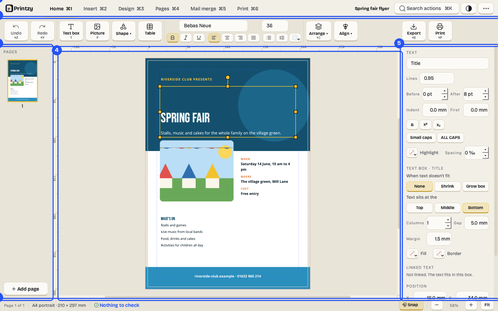

1. **The top bar** has the tabs (Home, Insert, Design, Pages, Mail merge, Print), the document's name, **Search
   actions** and the menu. A dot after the name means there are unsaved changes.
2. **The ribbon** under the tabs has the buttons for that tab. Each shows its keyboard shortcut.
3. **The pages panel** shows every page. Click one to go to it, drag to reorder, right-click for more.
4. **The page.** Click something to select it, double-click a text box to type in it, scroll to move around,
   and hold Ctrl while you scroll to zoom.
5. **The Format panel** changes whatever is selected: text, colours, lines, position and size. With nothing
   selected it shows the page: size, background and master page.
6. **The status bar** shows the page, its size, how many things the [design checker](#28-the-design-checker)
   found, Snap, and the zoom.

Home (Ctrl+H) is where you open files, rescue a folder, start from a template or a blank page, and find recent
files.

# Part 2. Your Publisher files

## 6. Open a .pub file

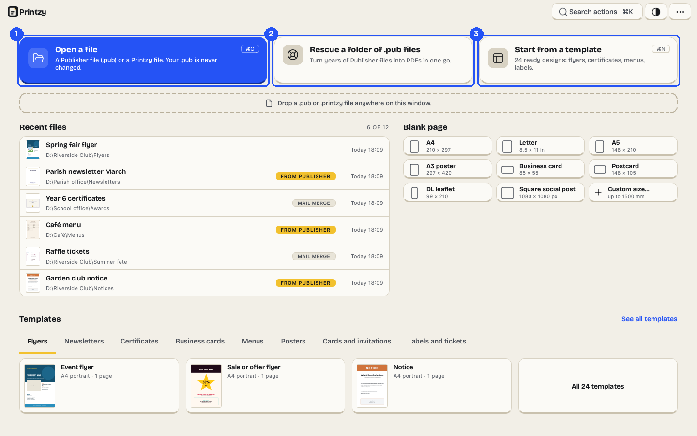

1. **Open a file** (Ctrl+O) and choose the `.pub` file. You can also drop it anywhere on Printzy's window, or
   double-click it in File Explorer if `.pub` files open with Printzy.
2. **Rescue a folder of .pub files** converts many at once (see [Rescue a folder](#10-rescue-a-folder)).
3. **Start from a template** opens the template gallery.

While a file opens, Printzy shows its progress. Large files with many pictures take longer. When it's open, an
information bar under the ribbon says it came from a Publisher file and how many things changed, with buttons
for the import report and **Export PDF**.

Your `.pub` file is never changed. To keep your edits, save (Ctrl+S): Printzy saves a `.printzy` file beside the
`.pub`.

If you drop several `.pub` files at once, Printzy asks whether to open them all or rescue them all to PDF.

## 7. The import report

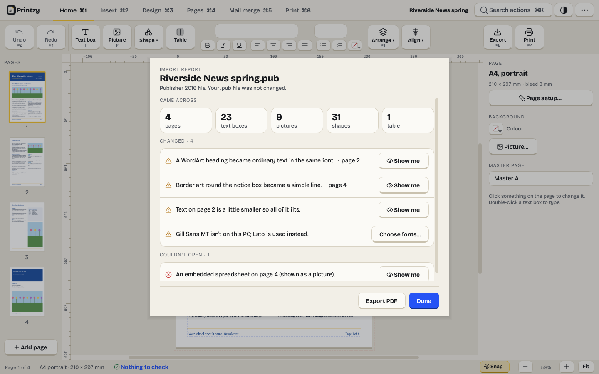

The import report opens with each Publisher file (and from the information bar). It has three parts:

- **Came across:** how many pages, text boxes, pictures, shapes and tables Printzy read.
- **Changed:** things that look a little different from Publisher, each in a plain sentence, such as "A WordArt
  heading became ordinary text in the same font." **Show me** takes you to it on the page.
- **Couldn't open:** anything Printzy couldn't read, such as an embedded spreadsheet. Where it can, Printzy shows
  it as a picture so nothing disappears.

**Export PDF** saves the file as a PDF straight away. **Done** closes the report; open it again from the
information bar.

## 8. Missing fonts

Publisher files name their fonts. If a font isn't on your PC, Printzy uses a close match: a font with the same
widths where there is one (Carlito for Calibri, Liberation Sans for Arial), otherwise one that looks similar. The
import report and the design checker list the swaps.

To choose the fonts yourself:

1. Click **Choose fonts…** in the import report, or **Missing fonts** in the command search (Ctrl+K).
2. For each missing font, pick the font to use instead. The list shows the pages it's used on.
3. Tick **Remember for next time** to use the same choice whenever a file names that font.
4. Click **Use these fonts**. The text reflows.

The original font names stay in the file, so if you install the real font later, Printzy uses it.

## 9. Convert with your installed Publisher

If Publisher is still installed on the PC, Printzy can ask it for an exact PDF of a `.pub` file. This button only
appears on PCs with Publisher, and only on Windows.

1. Open the `.pub` file in Printzy.
2. Click **Convert with Publisher** in the information bar or the import report.
3. Printzy opens a copy of the file in Publisher in the background, saves it as a PDF next to the `.pub`, and
   closes Publisher again.
4. When it says **Done: exact PDF saved.**, click **Open PDF**.

If Publisher stops to ask something (activation or a licence screen), Printzy brings its window to the front and
says "Publisher needs your attention." Finish in Publisher's window, then click **Continue**.

## 10. Rescue a folder

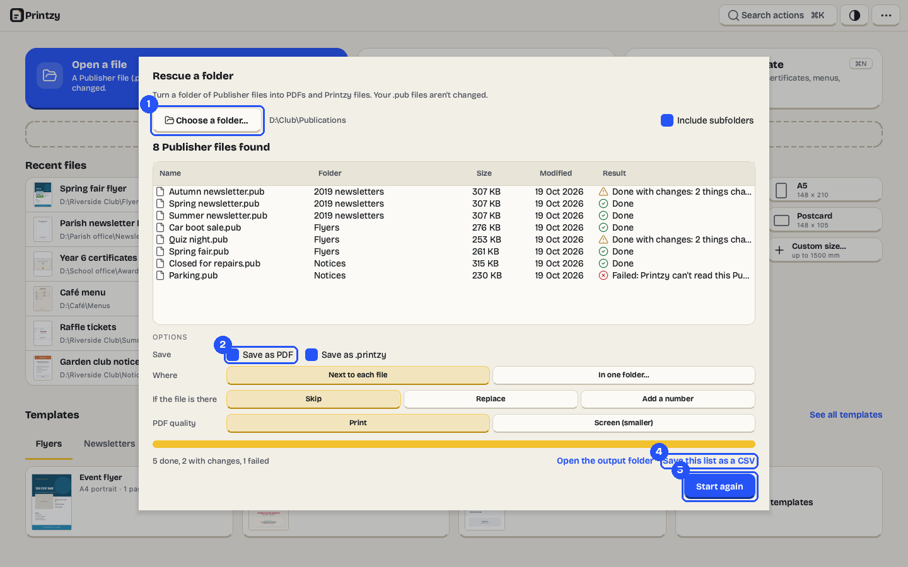

1. On Home, click **Rescue a folder of .pub files**, then **Choose a folder…**. Subfolders are included unless you
   untick **Include subfolders**. Printzy lists every `.pub` it found.
2. Choose what to save: **Save as PDF**, **Save as .printzy**, or both; **Next to each file** or **In one folder**;
   what to do **if the file is there** (Skip, Replace, or Add a number); and the PDF quality.
3. Click **Start rescue**. Each file shows Working, then Done, Done with changes, or Failed with the reason. You
   can **Pause**, and **Cancel** stops after the file being converted. Printzy keeps the PC awake while it runs,
   and you can carry on using Printzy.
4. When it finishes, **Save this list as a CSV** for a spreadsheet of every file and its result, or **Open the
   output folder**. Double-click a file that changed to see its import report.

If Publisher is installed, you can choose **Your installed Publisher** as the engine (exact but slower), and
**Retry failed with Publisher** converts the files Printzy couldn't read.

> Tip: run it again with **Skip** after adding files to the folder: only the new ones are converted.

## 11. What can't come across

Printzy reads `.pub` files with libmspub, from LibreOffice, with its own fixes. Most files come across well, but
some Publisher features become simpler:

- **WordArt** becomes ordinary text in the same font and colour.
- **Border art** (the decorative picture borders) becomes a simple line.
- **Embedded objects**, like a spreadsheet inside the page, are shown as a picture where Printzy can, and listed
  under Couldn't open otherwise.
- **Text in a missing font** may be a little smaller so all of it still fits. The report says which pages.
- **Publisher 2.0** files (from the early 1990s): the words come across, the layout doesn't.

Printzy saves `.printzy` files and PDFs. It can't save `.pub` files.

# Part 3. Make something

## 12. Start from a template

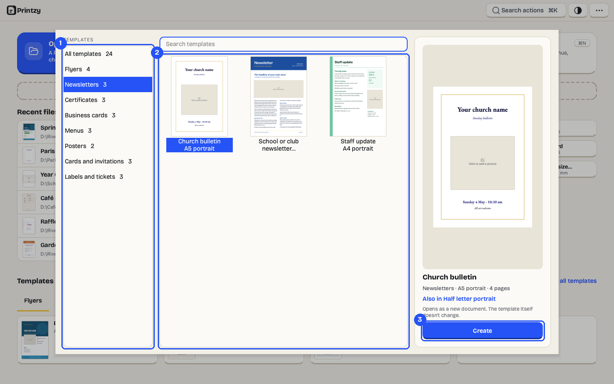

1. On Home, click **Start from a template** (or **See all templates**) and pick a category.
2. Click a template to see it on the right with its size and number of pages. Templates marked **Uses mail
   merge** have sample names you can replace with your own list. **Also in Letter** (or A4) switches to the other
   paper size.
3. Click **Create**. The template opens as a new, unsaved document; the template itself doesn't change.

Replace the words that say what to type ("Your event name") with yours, and fill the grey boxes that say **Click
to add a picture**. Empty picture boxes never print.

## 13. A blank page and page sizes

On Home, under **Blank page**, click a size: A4, Letter, A5, A3 poster, business card, postcard, DL leaflet or a
square social post. **Custom size…** lets you type any size up to 1500 × 1500 mm.

To change the size later, go to the **Pages** tab and click **Page setup** (or double-click a ruler). There you set
the size and orientation, margins, the bleed (see [Bleed and crop marks](#34-bleed-and-crop-marks)), column
guides, and **Facing pages** for documents printed on both sides.

## 14. Text boxes and text

- **Add a text box:** on the Insert tab click **Text box** (or press **T**), then drag on the page, or just click
  for a box of the usual size.
- **Type in it:** double-click the box. Press **Esc** when you've finished.
- **Format the text:** select words and use the buttons on the Home tab (font, size, bold, italic, alignment,
  bullets) or the Format panel (line spacing, space before and after, indents, colour, highlight, letter spacing,
  small capitals). Styles (Title, Heading 1, Body and so on) keep a document consistent.
- **Insert a symbol** (©, €, ½, ✓ and every character of the font) from the Insert tab, and fields such as the
  page number and date.
- **Find and replace** (Ctrl+F) searches every text box and table on every page, or just this one.

When text doesn't fit, a red **+** appears at the bottom of the box. Make the box bigger, choose **Shrink** or
**Grow** in the Format panel, or let the text carry on in another box (see [Text that flows between
boxes](#21-text-that-flows-between-boxes)).

## 15. Pictures

- **Add a picture:** on the Insert tab click **Picture** (or press **P**), or drop a picture file onto the page.
  Dropping it onto a grey picture box fills that box.
- **Crop:** double-click the picture (or click **Crop** in the Format panel). Drag the picture inside its box and
  drag the crop handles; press **Enter** to keep it or **Esc** to cancel. **Fit** shows the whole picture,
  **Fill** covers the box.
- **Replace** keeps the box, crop, border and effects and swaps the picture.
- **Adjust:** brightness, contrast, black and white, and transparency, without changing the picture itself.

The Format panel shows a picture's resolution at its size on the page ("142 ppi — fine for print"). Below
150 ppi, a picture may look blurry in print, and the design checker says so.

Printzy keeps a copy of every picture inside the `.printzy` file, so the document still works if you move or
delete the originals.

## 16. Shapes, lines, tables and QR codes

On the Insert tab:

- **Shape:** rectangle, rounded rectangle, circle or oval, triangle, line, arrow, star, speech bubble and banner.
  Change the fill, outline and corner radius in the Format panel.
- **Table:** drag to draw it, then click a cell to type. Tab moves to the next cell.
- **QR code:** type a web address or any text; the code updates as you type.

## 17. Arrange and align

- **Move** by dragging, or with the arrow keys. Blue lines appear when edges or centres line up (Snap, in the status
  bar, turns this on and off).
- **Resize** with the handles. Pictures keep their shape as you resize them (hold **Shift** to stretch them);
  for everything else, hold **Shift** to keep the proportions. **Rotate** with the round handle above.
- **Order:** Bring to front (Ctrl+Shift+]), Bring forward (Ctrl+]), Send backward (Ctrl+[), Send to back
  (Ctrl+Shift+[).
- **Align and distribute** on the Design tab: left, centre, right, top, middle, bottom, and even spacing.
- **Group** (Ctrl+G) and **Ungroup** (Ctrl+Shift+G). Double-click a group to change one thing inside it.
- **Lock** something so it can't be moved by accident; right-click it to unlock it.

Right-click anything for a menu of what you can do with it.

## 18. Colour and font schemes

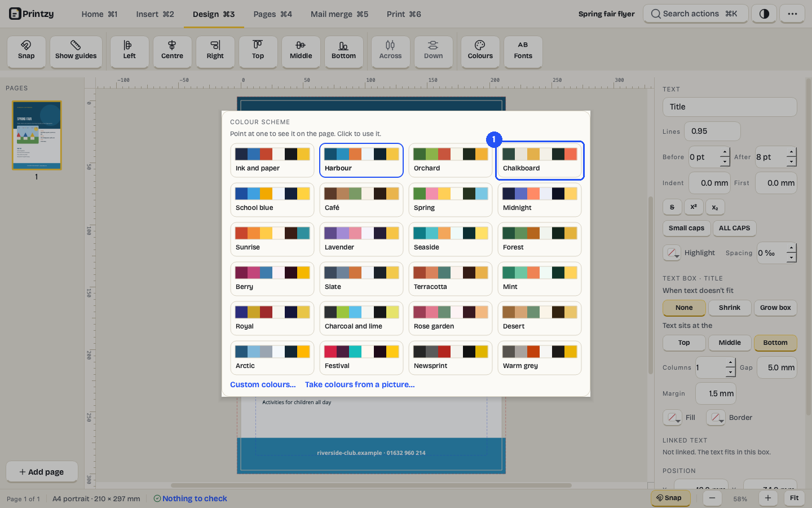

Every document has a **colour scheme** of six colours (Main, Accent 1, Accent 2, Light, Dark and Highlight) and a
**font scheme** (one font for headings, one for the rest). Things that use scheme colours and fonts change when
you change the scheme; things you gave a fixed colour stay as they are.

1. On the Design tab click **Colours** (or **Fonts**). Point at a scheme to see it on the page, and click it to
   use it. Ctrl+Z puts the old one back.

**Custom colours…** lets you pick the six colours yourself, and **Take colours from a picture…** builds a scheme
from your logo.

# Part 4. Longer documents

## 19. Pages and the pages panel

- **Add a page:** the **Add page** button under the pages panel, or the Pages tab.
- **Duplicate, delete, move:** right-click a page in the panel. Drag pages to reorder them.
- **Go to a page:** click it in the panel, or Page Up and Page Down.

For newsletters and booklets, turn on **Facing pages** in Page setup. The Pages tab then has **Spread**, which
shows the facing page beside the one you're working on; click it to work on it.

## 20. Master pages and page numbers

A master page holds what appears on many pages: a footer, a logo, a background. Every page uses **Master A**
unless you change it.

1. On the Pages tab click **Edit master page**. A yellow bar says which master you're editing and how many pages
   use it.
2. Add a text box for the footer, and on the Insert tab add **Field › Page number** (and **Page count** for "Page
   3 of 8"). Each page shows its own number.
3. Click **Close master**.

**Masters › New master page** makes Master B (for example for pages without a footer). Choose a page's master in
the Format panel with nothing selected, or right-click the page in the pages panel.

## 21. Text that flows between boxes

When a story is too long for its box, it can carry on in another box, on the same page or a later one.

1. Click the red **+** at the bottom of the full box.
2. Click an empty text box to carry on there, or click an empty part of the page to make a new box.

Text then moves between the boxes as you edit. Right-click a box and choose **Stop the text flowing on** to break
the link. Turn on **Show "Continued on page" notes** in the Format panel for "Continued on page 3" lines.

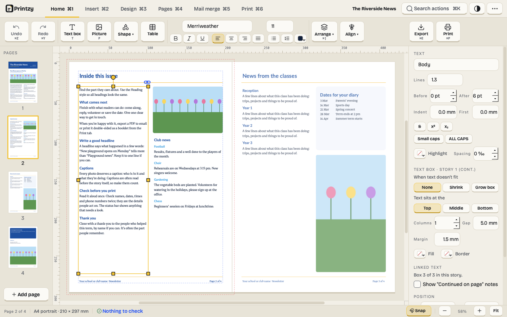

## 22. Make a newsletter

1. Start from **School or club newsletter** in the Newsletters templates.
2. Replace the masthead and headline, and paste your main story into the first column. It flows into the next
   columns and on to page 2.
3. Fill the picture boxes with your photos.
4. If you need another page, use **Add page**: the footer and page number come from the master page.
5. Check the status bar for anything worth a look, then print it or export a PDF.

## 23. Make a booklet

A booklet is printed two pages to a side and folded down the middle. Printzy puts the pages in the right order.

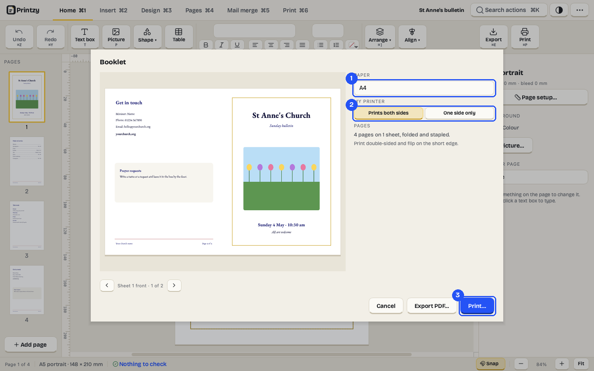

1. On the Print tab click **Booklet**. Choose the **paper**: A4 makes an A5 booklet, Letter a half-letter one.
2. Say whether your printer **prints both sides** or **one side only**. If the number of pages isn't a multiple of
   four, Printzy offers to add blank pages at the end.
3. Click **Print…** (or **Export PDF…**). With a one-sided printer, Printzy prints all the fronts, then asks you to
   turn the stack over and put it back in.

Fold the sheets in half, put them inside each other, and staple along the fold.

# Part 5. Mail merge

Mail merge makes one copy of a design for each row of a spreadsheet: a certificate for each pupil, a label for
each address. It never changes your spreadsheet.

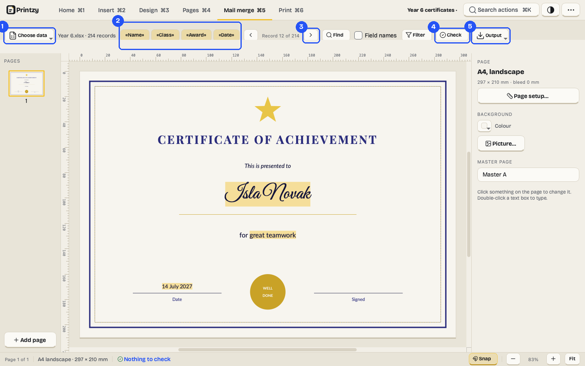

## 24. Certificates for a whole class

1. Start from **Achievement certificate**. On the **Mail merge** tab, **Choose data › Excel or CSV file…** and pick
   your spreadsheet (its first row holds the column names). Choose the sheet if it has several. Printzy shows the
   first ten rows and how many there are.
2. The columns appear as tags, such as **«Name»**. Click in a text box and click a tag to put it there, or drag a
   tag onto a text box.
3. Use the arrows to step through the records on the page. **Field names** shows «Name» instead of the names.
4. **Check** finds any record whose text doesn't fit ("Record 37: name too long for its box") and offers **Shrink
   text on overflow**.
5. **Output** makes the result: **Print all**, **One PDF with every record**, **One PDF per record** (named after
   each person, for example "Certificate - «Name»"), **Several per sheet**, or **Pictures per record**.

**Filter** includes only some records (for example, where Award isn't empty) and sorts them. **Find** jumps to
the record that contains some words. No spreadsheet? **Choose data › Type a list…** keeps a small list inside the
document.

> Tip: if you move the spreadsheet, Printzy says it isn't where it was. Choose it again from Choose data.

## 25. Address labels

1. Start from **Address labels** (Avery L7160 on A4, Avery 5160 on Letter).
2. Choose your address list on the Mail merge tab. Its columns replace the sample ones; put them in the label.
3. **Output › Several per sheet**. The sheet is already chosen, and each label gets the next address.
4. If some labels on the sheet are used, set **Start at item** to the first free one.
5. Click **Print…** and print at actual size.

## 26. Name badges with photos

1. Start from **Name badges**, and choose a spreadsheet with a column of photo file names (for example
   `photos/ana.jpg`, next to the spreadsheet).
2. Drag the photo column's tag onto a picture box. Each badge shows that person's photo.
3. **Output › Several per sheet** puts ten badges on an A4 sheet (eight on Letter).

## 27. Numbered tickets

No spreadsheet needed:

1. Start from **Raffle tickets**, then on the Print tab click **Several per sheet**.
2. Under **On each item** choose **Number them**: the first number, how many, how many digits, and what comes
   before the number ("No. "). The example shows "No. 0001".
3. Click **Print…** or **Export PDF…**. 400 tickets eight to a sheet make 50 sheets.

# Part 6. Printing and PDFs

## 28. The design checker

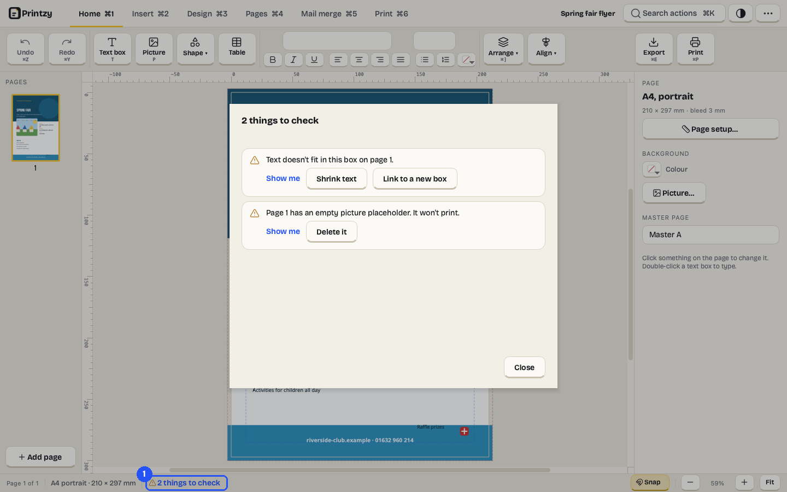

The design checker keeps an eye on the document while you work. The status bar says how many things it found
(**2 things to check**); click it to see them.

1. Each item says what's wrong in a sentence, with **Show me** and, where Printzy can, a fix: **Shrink text** or
   **Link to a new box** for text that doesn't fit, **Delete it** for an empty picture box, **Move inside** for
   something off the page, **Choose font** for a missing font.

Before you print or export a PDF for printing, Printzy shows the list if anything needs a look. You can fix
things or carry on anyway.

## 29. Export a PDF for printing

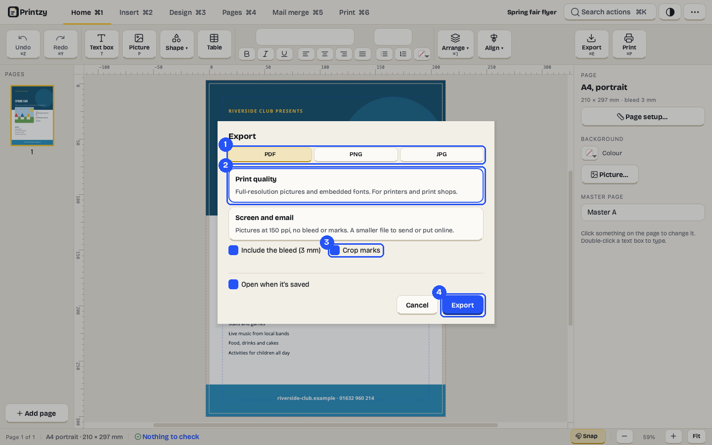

1. Press **Ctrl+E** (or Export on the Home or Print tab) and choose **PDF**.
2. Choose **Print quality**: full-resolution pictures and embedded fonts, for printers and print shops.
3. Include the **bleed** and **crop marks** if a print shop asks for them (see [Bleed and crop
   marks](#34-bleed-and-crop-marks)).
4. Choose the pages and click **Export**, then pick where to save it.

## 30. A PDF for email

In the Export window choose **Screen and email**. Pictures are made smaller (150 ppi), so the file is usually a
fraction of the size; Printzy shows roughly how big it will be before you export.

## 31. Pictures for social media

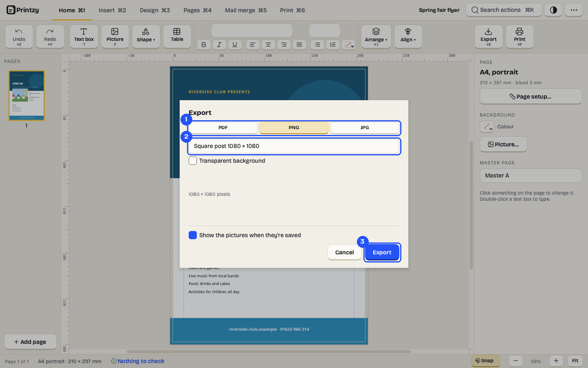

1. In the Export window choose **PNG** or **JPG**.
2. Choose the size: the page at 72, 150 or 300 dpi, a square post (1080 × 1080), a portrait post (1080 × 1350), a
   wide picture (1920 × 1080), or your own size. PNG can have a transparent background.
3. Click **Export**. Several pages are saved as numbered files: Flyer-1.png, Flyer-2.png and so on.

To paste a page into an email or a chat, use **Copy page as picture** (Ctrl+Shift+C).

## 32. Print at home

Press **Ctrl+P**. Choose the printer, the number of copies and which pages. The preview shows exactly what
prints: the paper's edge, and a dashed line where your printer can print. If something is outside that line,
Printzy warns you, because it may be cut off.

**Scale to fit paper** is on when the page and the paper are different sizes; choose **Actual size** to print at
100% (for labels and cards, always print at actual size). **Printer properties…** opens your printer's own
settings.

Picture boxes you haven't filled, guides and margins never print.

## 33. Several per sheet

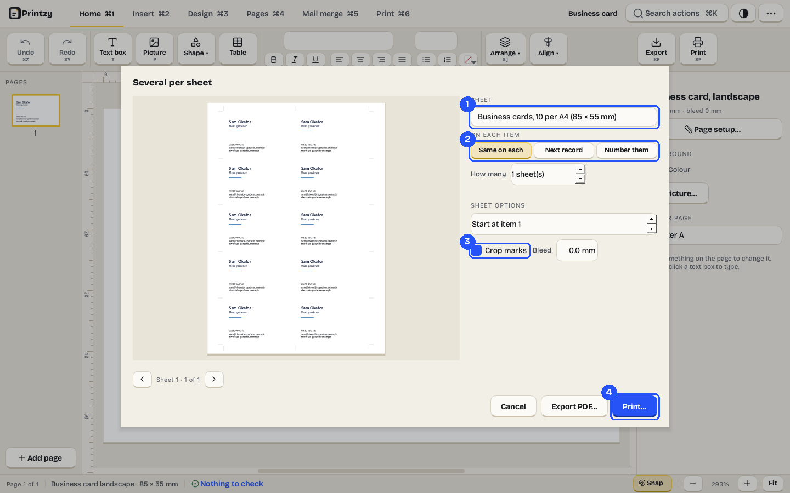

1. On the Print tab click **Several per sheet**, and choose the sheet: business cards (10 per A4 or Letter), Avery
   labels (L7160, L7163, L7651, 5160, 5163, 5164, 5167), tickets or badges, or **Custom** for your own layout.
2. Choose what goes on each item: the same design, the next mail merge record, or numbers.
3. Turn on **Crop marks** if you'll cut the sheet yourself.
4. Click **Print…** or **Export PDF…**.

A design with a second page (a two-sided business card) prints its backs on a second sheet, mirrored so they line
up. Print double-sided and flip on the long edge.

## 34. Bleed and crop marks

If a colour or picture should run right to the edge of the paper, a print shop prints on bigger paper and cuts it
down. The **bleed** is the extra 3 mm of your design beyond the edge, so nothing white shows if the cut is a little
off. **Crop marks** are the thin lines in the corners that show where to cut.

Templates meant for print shops already have a bleed (the red dashed line around the page). Stretch backgrounds to
that line, keep text at least 3 mm inside the page edge, and export with the bleed and crop marks. Home printers
can't print to the edge, so for printing at home you don't need either.

# Part 7. Settings

## 35. Settings, group by group

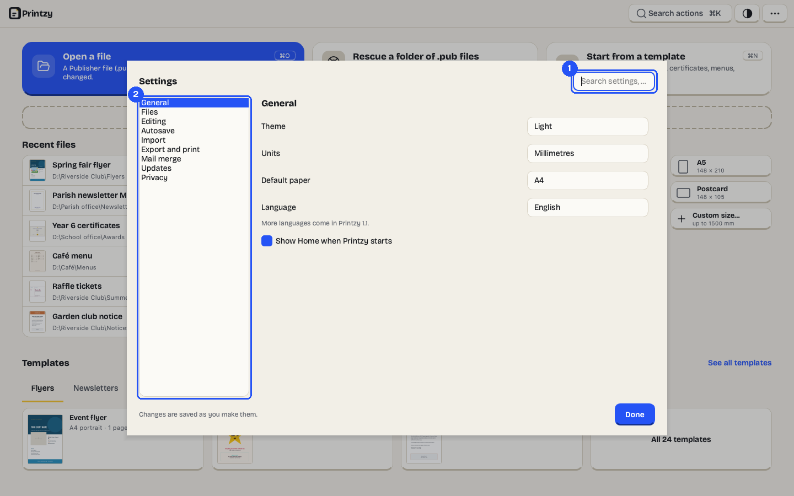

Open Settings with **Ctrl+,** or from the menu. Changes are saved as you make them.

1. Type in the **search box** to find a setting by its words ("bleed", "snap", "pub").
2. Or pick a **group**:

- **General:** theme (Light, Dark or Match Windows), units, default paper, language, and whether to show Home when
  Printzy starts (if not, it starts with a blank page).
- **Files:** open `.pub` files with Printzy (Windows may ask you to confirm in its own "Open with" window), the
  default save folder, how many recent files to show, and Clear recent files.
- **Editing:** what to snap to, smart guides, how far the arrow keys move things, rulers, the inner margin of new
  text boxes, and the font for new text.
- **Autosave:** how often Printzy saves a recovery copy (or never), the recovery folder, and how long to keep
  recovery files.
- **Import:** the fonts to use instead of missing ones, always showing the import report, and whether to use an
  installed Publisher (ask each time, always, or never).
- **Export and print:** the default PDF, the default bleed, crop marks, and opening the PDF when it's saved.
- **Mail merge:** the file names for one PDF per record, and the text encoding for CSV files when it isn't clear.
- **Updates:** check for a new version once a day, and Check now.
- **Privacy:** a list of every connection Printzy made, with the time, address and why. Normally that's only update
  checks. Clear the log whenever you like.

# Part 8. Help

## 36. Keyboard shortcuts and searching for actions

Press **Ctrl+K** to search every action by its words ("export pdf", "add page", "align left", "dark theme"), your
recent files and the templates. Press **?** (when you aren't typing) for the full list of shortcuts.

| Action | Shortcut |
|---|---|
| New blank page / Open / Home | Ctrl+N / Ctrl+O / Ctrl+H |
| Save / Save as | Ctrl+S / Ctrl+Shift+S |
| Export / Print | Ctrl+E / Ctrl+P |
| Undo / Redo | Ctrl+Z / Ctrl+Y |
| Cut / Copy / Paste / Paste as plain text | Ctrl+X / Ctrl+C / Ctrl+V / Ctrl+Shift+V |
| Duplicate / Delete / Select all | Ctrl+D / Delete / Ctrl+A |
| Group / Ungroup | Ctrl+G / Ctrl+Shift+G |
| Bring forward / to front | Ctrl+] / Ctrl+Shift+] |
| Send backward / to back | Ctrl+[ / Ctrl+Shift+[ |
| Bold / Italic / Underline | Ctrl+B / Ctrl+I / Ctrl+U |
| Align text left / centre / right / justify | Ctrl+L / Ctrl+E (in text) / Ctrl+R / Ctrl+J |
| Find and replace | Ctrl+F |
| Text box / Picture | T / P |
| Zoom in / out / fit page / 100% | Ctrl+= / Ctrl+- / Ctrl+0 / Ctrl+Alt+0 |
| Next / previous page | Page Down / Page Up |
| Tabs | Ctrl+1 to Ctrl+6 |
| Search actions / Settings / Shortcuts | Ctrl+K / Ctrl+, / ? |

Ctrl+E is Export, except while you're typing in a text box, where it centres the text, as in Office.

## 37. Updates

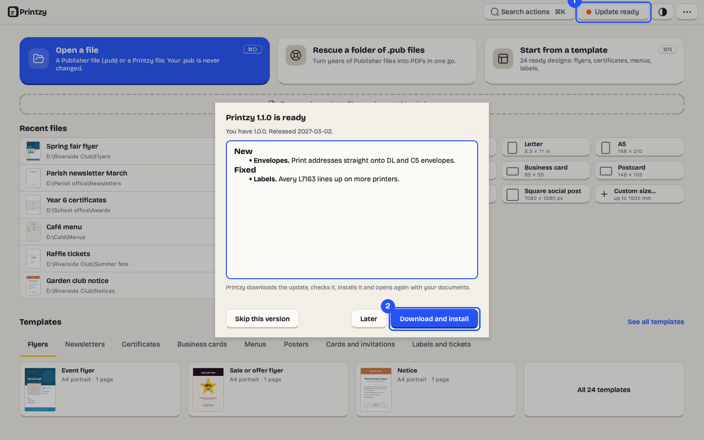

Once a day Printzy checks whether a new version is out. Nothing pops up: an **Update ready** key appears in the
top bar.

1. Click **Update ready** to see what's new.
2. Click **Download and install**. Printzy downloads the update, checks that it's exactly the published file, and
   installs it. Windows asks for permission once. Printzy then starts again and reopens the documents you had
   open. **Later** keeps it for another time, and **Skip this version** hides it until the next one.

If the download doesn't match the published file, nothing is installed and Printzy says so; try again later. On
Linux, the update window links to the new AppImage instead. To check by hand, use **Check for updates** in the
menu. To stop the daily check, untick it in Settings › Updates.

## 38. Your files and recovery

- **Saving:** Ctrl+S saves a `.printzy` file. The first time, you choose where. Printzy writes the whole file
  before replacing the old one, so a power cut never leaves a broken file.
- **Autosave:** every two minutes (you can change this), Printzy keeps a recovery copy of each open document in
  its own folder. It never overwrites your file until you save.
- **After a crash:** the next time Printzy starts, it lists the documents that weren't saved, with the time of the
  last copy. **Restore** opens them; **Delete** throws the copy away.
- **Closing:** if a document has changes, Printzy asks whether to save them.

## 39. If something goes wrong

- **"This file isn't a Publisher file Printzy can read."** The file may be damaged, or saved by another program
  with a `.pub` name. Try opening it in Publisher on another PC.
- **"Printzy can't read this Publisher version yet."** If Publisher is still installed on a PC, Convert with
  Publisher can save it as PDF.
- **"This file is protected, so Printzy can't open it."** Remove the password in Publisher first.
- **"Printzy couldn't finish opening this file. Nothing was changed."** Send the file to support@zylio.net if
  you'd like us to look.
- **Text runs off a box after opening a `.pub`.** A font is missing; see [Missing fonts](#8-missing-fonts).
- **The print is cut off at the edges.** Check the print preview's dashed line, and move things inside it.
- **Labels don't line up.** Print at **Actual size**, not Scale to fit, and check the sheet chosen in Several per
  sheet matches the box your labels came in.

## 40. Uninstalling

On Windows, go to **Settings › Apps**, find **Printzy** and click **Uninstall**. This removes the app, its Start
menu entry and the `.pub` and `.printzy` file associations. It asks whether to delete Printzy's settings and
recovery files too (No unless you choose Yes). Your documents are never touched.

On Linux, delete the AppImage file.

## 41. Words you will see

- **.pub file:** a Publisher document.
- **.printzy file:** a Printzy document. It keeps your pictures inside it.
- **Import report:** the list of what came across from a `.pub` file and what changed.
- **Template:** a ready-made design you start from.
- **Picture box:** a grey box that says Click to add a picture. Empty ones never print.
- **Colour scheme / font scheme:** the six colours and two fonts a document uses, changed all at once.
- **Master page:** a page whose contents (a footer, page numbers) appear on every page that uses it.
- **Linked text boxes:** boxes that a story flows through, one after another.
- **Mail merge:** one copy of a design for each row of a spreadsheet.
- **Field:** a tag like «Name» that is replaced by each record's value, or by the page number or date.
- **Several per sheet:** many copies of a small design (cards, labels) on one sheet of paper.
- **Booklet:** pages printed two to a side, in the order that folds into a book.
- **Bleed:** the part of a design beyond the page edge, so colours reach the edge after cutting.
- **Crop marks:** short lines in the corners that show where to cut.
- **ppi:** pixels per inch, how sharp a picture prints at its size. 150 or more is fine for print.

## 42. Get help

- This guide, at zylio.net/software/printzy/guide (also **User guide** in the menu, or F1).
- Email **support@zylio.net**. Attach the `.pub` file if a file doesn't open as you expect; we only use it to
  look at the problem.
- **About Printzy** in the menu shows the version and the licences of the parts Printzy is built from.
